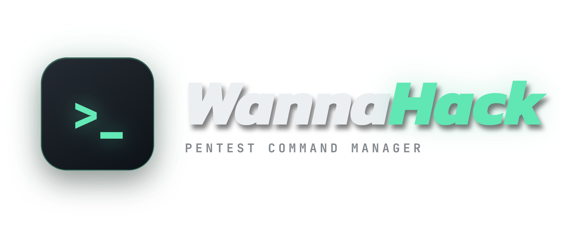
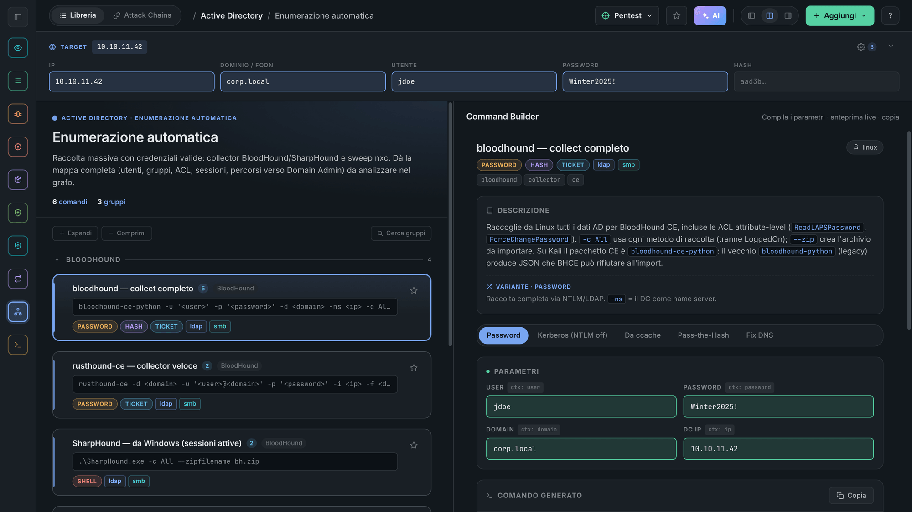
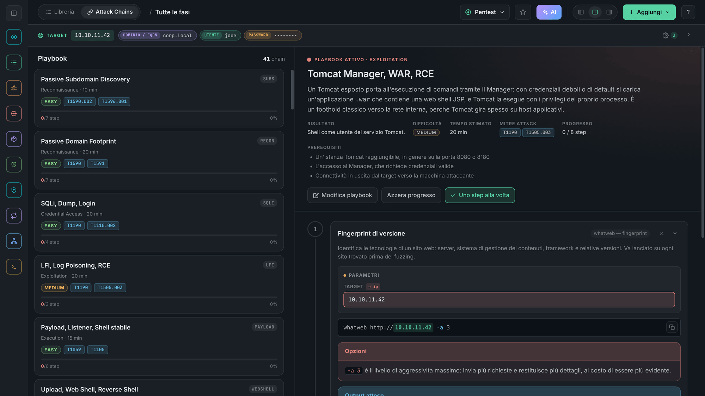
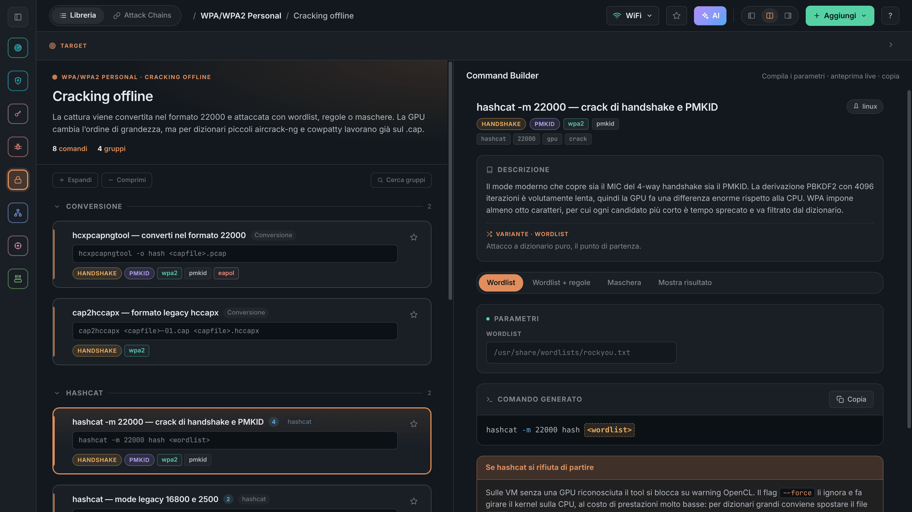
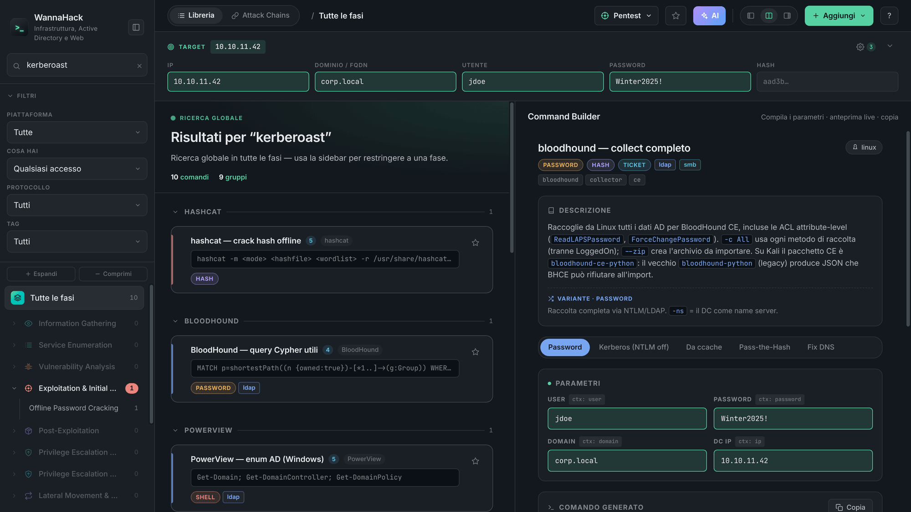
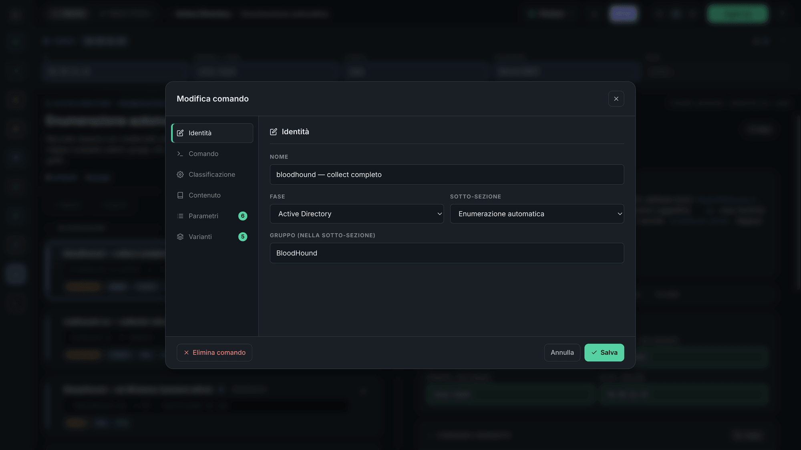

<p align="center">
  
</p>

<p align="center">
  <b>Command reference and attack playbooks for authorized penetration testing and wireless assessments.</b><br>
  Every command comes out already filled in with your target, ready to copy. Runs locally: no build step, no backend.
</p>

<p align="center">
  <a href="LICENSE"></a>
  
  
  
  
  <br>
  
  
  
</p>

<p align="center">
  <a href="#features">Features</a> •
  <a href="#screenshots">Screenshots</a> •
  <a href="#quick-start">Quick start</a> •
  <a href="#disciplines">Disciplines</a> •
  <a href="#library-and-attack-chains">Library and Attack Chains</a> •
  <a href="#ai-search">AI Search</a> •
  <a href="#keyboard-shortcuts">Shortcuts</a> •
  <a href="#data-model">Data model</a> •
  <a href="#license">License</a> •
  <a href="#disclaimer">Disclaimer</a>
</p>

<p align="center">
  
</p>

During a pentest you keep typing the same commands with different parameters (IP, domain, user, hash), in a specific order. WannaHack covers the two things you actually lose time on:

- *"What was that command again?"* The **Library** is a searchable catalogue of commands split by engagement phase, each with a description, variants and reference links.
- *"What do I do next?"* The **Attack Chains** are playbooks: sequences of linked commands (Kerberoasting, then cracking, then lateral movement) with an objective, prerequisites, MITRE ATT&CK mapping and step by step progress.

Both sit on a shared **Target**. You type the IP, domain and user once, and every command shows up already rewritten with those values, ready to copy.

| 508 | 67 | 18 | 2 | 0 |
|:---:|:---:|:---:|:---:|:---:|
| commands | attack playbooks | phases | disciplines, Pentest and WiFi | build steps or backends |

## Features

- **Commands that fill themselves in.** Parameters take their values from the Target (IP, domain, user, password, hash, LHOST, LPORT, interface), and placeholders you still have to fill are highlighted in the generated command.
- **A library organised like an engagement.** Phases, subphases and groups follow the methodology, from Information Gathering to Active Directory, with variants for every tool, notes on expected output and common errors, and reference links.
- **Playbooks you can follow step by step.** Each Attack Chain has an objective, prerequisites, difficulty, estimated time and MITRE ATT&CK techniques. Every step points at a Library command, keeps its own status and notes, and tells you the signal that it worked.
- **Two disciplines.** Pentest (infrastructure, Active Directory, Web) and WiFi (802.11 assessments) each bring their own phases, Target fields and access filters.
- **Search that finds what you mean.** Instant search on names, descriptions, tags and variants (`Ctrl+K`), filters by platform, access level, protocol and tag, plus an AI search in natural language that can only answer with commands and playbooks that already exist.
- **Yours to extend.** Add and edit commands and playbooks, rename and reorder phases and groups, hide what you do not need, mark favourites, and export everything back to the source files.
- **Keyboard first.** Shortcuts for search, views, favourites and collapsing (`?` lists them in the app).
- **Local and static.** Plain HTML, CSS and one React file compiled in the browser. A small Python server on the folder is all it needs, and your changes live in the browser.

## Screenshots

<table>
  <tr>
    <td width="50%" valign="top">
      
      <p align="center"><sub><b>Attack Chains</b>: playbook with objective, MITRE techniques and step timeline</sub></p>
    </td>
    <td width="50%" valign="top">
      
      <p align="center"><sub><b>WiFi</b>: WPA/WPA2 offline cracking with its own phases and Target</sub></p>
    </td>
  </tr>
  <tr>
    <td width="50%" valign="top">
      
      <p align="center"><sub><b>Search</b>: results across every phase, with filters and counts</sub></p>
    </td>
    <td width="50%" valign="top">
      
      <p align="center"><sub><b>Editor</b>: add or change commands and playbooks from the UI</sub></p>
    </td>
  </tr>
</table>

## Quick start

### Prerequisites

- **Python 3**, it runs the local server (`launcher/serve.py`). Conda installs are picked up first, a system `python3` works too
- A modern browser
- Internet on the first load: React, Babel and the fonts come from a CDN

### Launchers

`launcher/` has two scripts that put an icon on the Desktop and start the app after checking the environment.

**Linux / macOS**

```bash
cd launcher
./command-manager.sh status      # check the environment (changes nothing)
./command-manager.sh install     # put the icon on the Desktop (uses the logo in assets/)
./command-manager.sh             # start now (server + browser)
./command-manager.sh uninstall   # remove the icon from the Desktop (the logo stays)
```

After `install` you get **WannaHack** on the Desktop. If an older version left a `WannaHack Command Manager` icon there, `install` and `uninstall` delete it.

**Windows**

One `.bat` file (cmd) with the same commands as the `.sh`.

```bat
cd launcher
command-manager.bat install      :: once, creates the Desktop icon
command-manager.bat              :: start now (server + browser)
command-manager.bat help         :: help (also -h, --help)
```

| Command | Action |
|---------|--------|
| `launch` (default) | Picks a free port, starts the Python server, opens the browser, keeps the server alive until you close the window |
| `install` | Puts the launcher on the Desktop (`.desktop` on Linux, `.lnk` on Windows) |
| `uninstall` | Removes the Desktop icon. The logo files in `assets/` and the app stay where they are |
| `status` | Checks app files, Python (conda first), free port, icons. Writes nothing |
| `help` | Shows the help. Also `-h` / `--help` |

The server is `launcher/serve.py`: `http.server` plus no-store headers, so after you edit `app.jsx` or a data file the next reload shows the new version instead of the cached one. To start it by hand, run `python3 launcher/serve.py` from the repository root and open `http://127.0.0.1:8787`.

## Disciplines

The dropdown in the top bar switches **discipline**. Each one brings its own phases, its own Target fields and its own access filters; the rest of the UI stays the same.

### Pentest (infrastructure, Active Directory, Web)

397 commands, 41 playbooks, 10 phases. Target: `ip`, `domain`, `user`, `password`, `hash`, plus `lhost`, `lport` and `iface` in the advanced settings (⚙ in the Target bar).

| # | Phase | Content |
|---|-------|---------|
| 1 | **Information Gathering** | Passive recon (OSINT, CT logs, DNS) and active recon (port scan, web and DNS discovery) |
| 2 | **Service Enumeration** | One subphase per service, ordered by port: FTP, SSH, SMTP, DNS, Web apps, IMAP/POP3, SNMP, LDAP, SMB, RTSP, IPMI, rsync, MSSQL, Oracle TNS, NFS, MySQL, RDP, PostgreSQL, VNC, WinRM, Redis, Elasticsearch, Memcached, MongoDB |
| 3 | **Vulnerability Analysis** | Web app testing (SQLi, XSS, LFI, XXE, SSRF, file upload, command injection, SSTI, JWT, deserialization, GraphQL, exposed .git) and infrastructure CVE hunting |
| 4 | **Exploitation & Initial Access** | Payloads, listeners, web shells, shell stabilization, infrastructure exploits, credential attacks, offline password cracking, social engineering, AV bypass |
| 5 | **Post-Exploitation** | Situational awareness, credential harvesting, pillaging, persistence, file transfer |
| 6 | **Privilege Escalation — Linux** | Auto enumeration, sudo, SUID/SGID, capabilities, cron jobs, kernel exploits, NFS and container escape |
| 7 | **Privilege Escalation — Windows** | Auto enumeration, token privileges, privileged groups, vulnerable services, scheduled tasks, AlwaysInstallElevated, credential hunting, kernel exploits |
| 8 | **Lateral Movement & Pivoting** | Remote shells (PsExec, WMI, WinRM), Pass-the-Hash, Pass-the-Ticket, pivoting tools (Chisel, Ligolo, Proxychains) |
| 9 | **Active Directory** | Setup, unauthenticated recon, automated and manual enumeration (BloodHound, LDAP, PowerView), initial access, domain privilege escalation (ACL, ADCS, DCSync), domain persistence |
| 10 | **Utilities** | Reverse shells, GTFOBins, LOLBins, cheatsheets (hashcat, file transfer, cURL) |

Access filter: `no-creds`, `password`, `hash` (NTLM), `ticket` (Kerberos), `cert` (PFX), `shell`.

### WiFi (802.11 wireless assessment)

111 commands, 26 playbooks, 8 phases. Target: `iface`, `mon`, `bssid`, `essid`, `channel`, `client`, `capfile`, `password`.

| # | Phase | Content |
|---|-------|---------|
| 1 | **Recon & Interface** | Interface and driver capabilities, monitor mode, AP and client discovery, capture analysis |
| 2 | **Bypassing basic controls** | Hidden SSIDs, MAC filtering |
| 3 | **Wi-Fi Protected Setup** | WPS recon, online PIN brute force, Pixie Dust, default PINs and lock bypass, push button configuration |
| 4 | **Wired Equivalent Privacy** | IV generation, PRGA recovery and forging, WEP cracking |
| 5 | **WPA/WPA2 Personal** | 4-way handshake and PMKID capture (clientless), offline cracking |
| 6 | **WPA/WPA2 Enterprise** | EAP recon, online brute force, rogue AP and downgrade, relay and hash cracking |
| 7 | **Evil Twin & MiTM** | Rogue AP with captive portal, MiTM from the rogue AP |
| 8 | **Post-connection** | Connecting, LAN recon once you are inside the network |

Access filter: nothing (monitor only), captured handshake, captured PMKID, captured EAP hash, recovered PSK, valid EAP credentials.

## Library and Attack Chains

Switch between the two from the top bar or with keys `1` and `2`.

### Library

- Commands grouped by phase, subphase and group (Information Gathering, then Passive Recon, then DNS Records). Phases and subphases are declared in `categories.js`; groups are a free text field on the command, suggested from the ones already in use so a typo does not silently create a new one.
- Every command is a card: name, when and why to use it, the command template, tags, variants, and reference links (HackTricks, RFCs, official docs).
- Split view with the list on the left and the Command Builder on the right, or the Builder only from the layout toggle.
- One click copy, and what lands in the clipboard is already filled in with the Target values.

### Attack Chains

- Every chain carries an objective, expected outcome, prerequisites, difficulty, estimated time and MITRE ATT&CK techniques.
- It is a sequence of steps. Each step points at a Library command (`cmdRef`), optionally pinned to one of its variants, and can override single parameters.
- Progress is per step: `todo`, `active`, `done` or skipped, with a notes field for output and observations.
- Each step has a `verify` line: the observable signal that tells you it worked.

### Customising

- Add and edit commands and playbooks from the UI, building playbooks step by step.
- Edit phases, subphases and groups from the Add menu ("Fasi e gruppi…"): create, rename, recolour, pick an icon, reorder by dragging. Renaming an id reassigns every command and playbook that points at it, after a confirmation that tells you how many.
- Deleting a phase removes its subphases, commands, playbooks and groups in cascade; deleting a subphase removes only its own. Built-in entries are hidden rather than erased from the files.
- Hide the commands and chains you do not need, reorder lists and steps, and collapse groups and phases to cut the noise (`E`, `C`, `G`).
- **JSON backup**: export everything (favourites, custom entries, custom taxonomy, progress, Target) to a file and import it back later. The import overwrites the current state, and the Target values, password and hash included, are written in clear.
- **Source export**: regenerate `data.js`, `chains.js` and `categories.js`, built-in and custom merged, ready to drop back into the repo. The first two are scoped to the active discipline, `categories.js` carries every discipline.
- **Clear cache**: back to the original file data, dropping every local change, the custom taxonomy and the OpenAI key included.

Favourites, custom entries, progress and the Target are saved in the browser localStorage, which belongs to the address you open the app from. The launchers always start from port 8787 and move to the next one only when it is busy: on a different port, or in a different browser, your local data are not there until you go back to the usual address or import a backup.

## AI Search

The AI button in the top bar opens a natural language search over the library. Your request is mapped onto commands and playbooks that already exist, and the model can only answer with their ids: nothing is executed and nothing is invented. Optionally it adds a short explanation, and a suggested command when the library really has no match.

**Pentest and WiFi are searched separately.** The index sent to the model is built from the active discipline only, so a WiFi search can never return a Pentest id and the other way round. The last search is also saved per discipline, so switching does not leave you looking at results from the other one.

The system prompt adapts to the discipline through placeholders:

| Placeholder | Filled with |
|-------------|-------------|
| `{{DISCIPLINE}}` | Discipline name (`Pentest`, `WiFi`) |
| `{{PHASES}}` | The phases actually present in the index, so the model does not suggest work outside them |
| `{{TARGET_KEYS}}` | Target placeholders of the discipline (`<ip> <user> …` or `<iface> <bssid> …`), used by suggested commands |
| `{{MAX_RESULTS}}` | Max number of commands to return |
| `{{COMMAND_INDEX}}` / `{{CHAIN_INDEX}}` | The two indexes, one line per entry |

The settings are shared by both disciplines: one API key, one model, one prompt template.

- The provider is the OpenAI API, called straight from the browser.
- `config/secret.env` holds the configuration and is gitignored. Copy `config/secret.env.example` and put your key in it.
- `config/ai-system-prompt.md` holds the prompt template. Edit it there or from the modal.
- Whatever you change in the modal goes to localStorage and wins over the files. The API key is the exception: it is read from `secret.env` when the field is empty. "Restore settings" rereads both files.
- Queries go to OpenAI, so do not paste real target data into them.

## Keyboard shortcuts

| Keys | Action |
|------|--------|
| `Ctrl` + `K` | Focus the search |
| `Ctrl` + `B` | Open / close the sidebar |
| `?` | Show all shortcuts |
| `Esc` | Close modals and popups |
| `1` | Library view |
| `2` | Attack Chains view |
| `F` | Show / hide favourites |
| `E` / `C` | Expand / collapse all phases |
| `G` | Expand / collapse all groups |

## Data model

The data are plain JavaScript objects. To add things by hand edit `data.js` and `chains.js`, or `data-wifi.js` and `chains-wifi.js` for the WiFi discipline. You can also do it from the UI and export.

```text
index.html          entry point: loads React, Babel and the data files
js/app.jsx          the whole UI, compiled in the browser by Babel
css/styles.css      styles and colour tokens (dark theme with mint accent, one colour per phase)
data/               categories.js, data.js, chains.js and their -wifi counterparts
config/             ai-system-prompt.md and secret.env.example (secret.env is gitignored)
launcher/           serve.py and the Desktop launchers (.sh, .bat)
assets/             logo, icons and the README screenshots
```

<details>
<summary><b>Command</b> (<code>data.js</code>)</summary>

```js
{
  id: 'whois-domain',                 // unique identifier
  name: 'whois (domain registration)',
  category: 'info-gathering',         // a phase id from categories.js
  subcategory: 'passive-recon',       // subphase
  group: 'WHOIS & ASN',               // visual grouping
  description: 'Registrar, dates, nameservers.',
  platform: 'cross-platform',         // linux | windows | cross-platform
  requires: ['no-creds'],             // access level, see the discipline
  protocols: [],                      // smb, ldap, http, ...
  tags: ['whois', 'osint'],
  template: 'whois <domain>',         // <param> = placeholder from the Target
  params: [                           // how to fill the placeholders
    { key: 'domain', label: 'Domain', ctx: 'domain', placeholder: 'example.com' },
  ],
  variants: [                         // optional, alternatives for the same tool
    { id: 'plain', label: 'Plain whois', template: 'whois <ip>', description: '...' },
  ],
  refs: [                             // optional, further reading
    { label: 'HackTricks, recon', url: 'https://...' },
  ],
}
```

</details>

<details>
<summary><b>Attack chain</b> (<code>chains.js</code>)</summary>

```js
{
  id: 'esc1-to-da',
  name: 'ADCS ESC1 to Domain Admin',
  short: 'ESC1',
  category: 'active-directory', subcategory: 'priv-esc',
  tactic: 'Privilege Escalation',
  difficulty: 'medium',               // easy | medium | hard
  estTime: '15 min',
  objective: 'What you get and how, in one sentence.',
  outcome: 'The concrete end result.',
  prereqs: ['Any domain account', '...'],
  mitre: ['T1649'],                   // MITRE ATT&CK techniques
  steps: [
    {
      id: 's1', title: 'Find vulnerable templates',
      cmdRef: 'certipy-find',         // id of a command in data.js
      variant: 'default',             // optional: pin one variant of that command
      overrides: { ca: 'CORP-CA' },   // optional: fixed values for single params
      verify: 'The observable signal that it worked.',
    },
  ],
}
```

</details>

<details>
<summary><b>Discipline</b> (<code>categories.js</code>)</summary>

<br>

A discipline is one object in `DISCIPLINES`: id, name, icon, blurb, `showPlatform`, its `targetFields` (the Target bar) and its `accessOptions` (the access filter). Categories join a discipline through `domain: '<discipline id>'`, and if it is missing they count as `pt`. To add a discipline you append an object here, its categories, and its data files loaded from `index.html`.

Categories and subcategories can also be edited from the UI and written back with "Esporta categories.js". Ids are what commands and playbooks reference, so changing one rewrites them: the app asks first and says how many are affected. A subphase id only has to be unique inside its own phase, which is why `persistence` can exist under both Post-Exploitation and Active Directory.

</details>

## License

Licensed under the MIT License. See [LICENSE](LICENSE). The MIT license covers WannaHack's own code only. The library content is written from personal notes and field experience, with parts reworked from third party sources (HTB Academy CPTS and CWPE, HackTricks, tool documentation) that remain with their respective authors.

## Disclaimer

WannaHack is a reference tool for authorized security testing, training labs and CTFs. It stores and formats commands, it does not run them: what you type into a terminal is on you.

Run these techniques only against systems you own or that you have explicit written permission to test. Unauthorized access to computer systems and networks is a crime in most countries, and scanning or attacking third party infrastructure without a mandate can get you prosecuted regardless of intent.

The software comes with no warranty. The author takes no responsibility for damage, data loss, service disruption or legal consequences from using it. Check the commands before running them, some are destructive by design.
